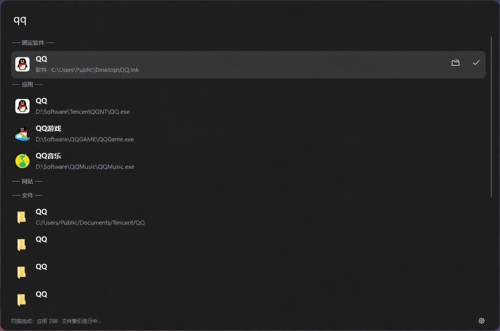

# 萤 · Hotaru

一款 Windows 桌面启动器。

[使用指南](docs/usage.md) · [功能变更](docs/changes.md) · [开发说明](docs/development.md)

**当前版本：1.0.0** · [项目仓库](https://github.com/EienSakura/Hotaru) · [版本发布](https://github.com/EienSakura/Hotaru/releases)

## 界面预览

### 固定面板

截图中的 QQ、微信为手动添加的示例，首次启动面板为空。

### 搜索界面

统一展示固定软件、应用、网站和文件结果，支持打开所在位置与快捷固定。

## 项目简介

Hotaru 延续 ltool 的全局热键、应用与文件搜索、拼音匹配、网站直达和 DLL 插件架构。上游还提供图片排版、随机数、JSON 格式化、Base64 等工具插件，完整功能与说明请参阅 [ltool README](https://github.com/mateo-ki/ltool#readme)。

本项目重点扩展启动器界面与日常操作，新增功能如下。

## Hotaru 新增功能

| 功能 | 说明 |
| --- | --- |
| 自定义固定面板 | 首次使用为空，右键添加程序、快捷方式、脚本或文件夹；支持 `.exe`、`.lnk`、`.bat`、`.cmd` 和文件夹。 |
| 自由格位与分页 | 默认每页 **4 行 × 8 列**，行列可调；允许留空、不自动补位，支持跨页拖动、增删页面和记住上次所在页。 |
| 图标分组 | 拖动合并图标，点击打开每页 **3×3** 的二级面板；支持重命名、解散和拖出子项，仅支持一层分组。 |
| 显示名与快捷操作 | 面板内重命名不改源文件；右键运行、管理员运行、定位、编辑属性或重新定位失效目标。 |
| 搜索快捷固定 | 搜索结果可直接打开所在位置、固定到面板；固定项及分组内软件参与搜索，并避免重复添加。 |
| 主题与皮肤 | 内置黑、灰、白主题，支持独立 ZIP 主题包的导入、切换和删除，以及透明外框、静态与 GIF 装饰。 |
| 紧凑模式与显示优化 | 可关闭“呼出时显示常驻网格”，仅显示搜索条并在搜索时展开；增加 DPI 高清图标，设置窗口独立配色并在启动器所在屏幕打开。 |

“常驻”仅指固定显示的启动项，不维持后台进程。重命名、分组和移除只修改面板配置，不改动源文件或磁盘目录。已有配置和插件文件会保留，默认不捆绑或自动安装工具插件，插件自动更新默认关闭。

**插件兼容说明：** 当前工具插件均来自上游 ltool，插件商店也沿用上游渠道；Hotaru 暂未进行插件兼容性测试，使用前需要自行适配和验证。默认安装包不含插件，需要时额外打包。

主题包

主题采用**本仓库 Release 独立 ZIP 附件**的分发方式，与程序分开下载、安装和更新，不额外建立主题仓库，也不打入主程序安装包。下载后在“配置 → 外观 → 导入主题包”中安装。

现在已有主题包会在1.0.0的release中加入。制作自己的主题请参阅[主题包设计规范](docs/theme-package.md)。

## 快速开始

1. 按 [开发说明](docs/development.md) 构建，在可写目录运行 `Hotaru.exe`。
2. 按 `Alt+Space` 或点击托盘图标呼出启动器。
3. 在空白格右键添加软件或文件夹，也可从搜索结果快捷固定。
4. 点击齿轮设置主题、网格大小、呼出模式和页面记忆。

固定项单击运行；搜索结果使用回车或双击打开。面板通过页码、滚轮或 `PageUp` / `PageDown` 翻页，不显示滚动条。更多操作见 [使用指南](docs/usage.md)。

## 构建与开发

技术栈：**C++20 · Qt 6 · CMake**。Windows 构建使用 Visual Studio 2022 C++ 工具链、Windows SDK 和 vcpkg；依赖清单固定 Qt 6.10.2。默认不构建工具插件，需要时显式开启 `HOTARU_BUNDLE_PLUGINS`。

依赖准备、构建命令和验证方式见 [开发说明](docs/development.md)。

## 文档

| 文档 | 内容 |
| --- | --- |
| [使用指南](docs/usage.md) | 面板、分页、分组、主题及配置备份。 |
| [功能变更](docs/changes.md) | Hotaru 相对上游的新增功能和修复。 |
| [开发说明](docs/development.md) | 构建、插件兼容、验证和发布现状。 |
| [主题包设计规范](docs/theme-package.md) | ZIP 结构、清单字段、外框布局、动画及发布方式。 |
| [上游文档](https://github.com/mateo-ki/ltool#readme) | ltool 原有功能与工具插件说明。 |

## 项目状态

**1.0.0 是 Hotaru 的首个版本**，以 Windows 为主要支持平台。

现有工具插件均为上游 ltool 插件，Hotaru 暂未进行兼容性测试。

## 许可证与致谢

感谢 [mateo-ki/ltool](https://github.com/mateo-ki/ltool) 提供基础实现。部分设计灵感来源 火萤酱。Hotaru 保留上游归属信息，代码沿用 [Apache-2.0 许可证](LICENSE)。第三方依赖与主题素材遵循各自许可。
