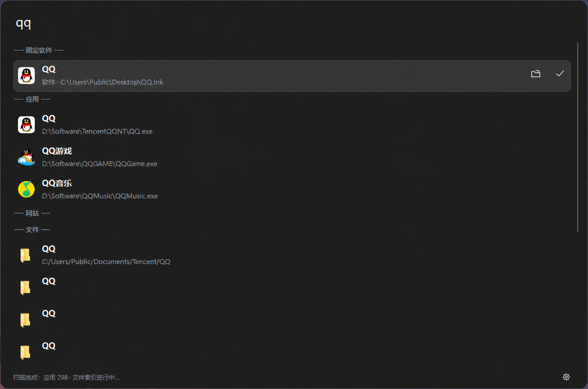

# 萤 · Hotaru

支持全局快捷搜索、自定义固定面板和主题包的 Windows 桌面启动器。

[下载安装](https://github.com/EienSakura/hotaru-launcher/releases/latest) · [使用指南](docs/usage.md) · [主题包](https://github.com/EienSakura/hotaru-launcher/releases/tag/v1.0.0#assets) · [功能变更](docs/changes.md)

**当前版本 1.1.0**

## 界面预览

### 固定面板

*图中的 QQ、微信为手动添加的示例，首次启动时面板为空。*

### 搜索界面

*统一搜索固定软件、应用、网站和文件，支持打开所在位置与快捷固定。*

## 快速开始

1. 从 [最新发布](https://github.com/EienSakura/hotaru-launcher/releases/latest) 下载 Windows x64 安装包。
2. 安装完成后，从开始菜单打开 Hotaru。按 `Alt+Space` 或点击托盘图标呼出启动器。
3. 在空白格右键添加软件或文件夹，也可从搜索结果快捷固定。
4. 点击齿轮进入「配置 → 外观」，调整主题、网格大小和打开面板时的页面策略。

固定项单击运行。搜索结果可用回车或双击打开。面板可通过页码、滚轮或 `PageUp` / `PageDown` 翻页。 [完整使用指南](docs/usage.md)

## Hotaru 新增功能

Hotaru 基于 ltool，沿用全局热键、拼音匹配、网站直达和 DLL 插件架构，重点扩展固定面板与主题。图片排版、随机数、JSON 格式化、Base64 等上游工具可通过兼容插件渠道安装。 [ltool 功能说明](https://github.com/mateo-ki/ltool#readme)

| 功能 | 说明 |
| --- | --- |
| 自定义固定面板 | 首次使用为空，右键添加程序、快捷方式、脚本或文件夹；支持 `.exe`、`.lnk`、`.bat`、`.cmd` 和文件夹。 |
| 自由格位与分页 | 默认每页 **4 行 × 8 列**，行列可调；允许留空、不自动补位，支持跨页拖动、增删页面和记住上次所在页。 |
| 图标分组 | 拖动合并图标，点击打开每页 **3×3** 的二级面板；支持重命名、解散和拖出子项，仅支持一层分组。 |
| 显示名与快捷操作 | 面板内重命名不改源文件；右键运行、管理员运行、定位、编辑属性或重新定位失效目标。 |
| 搜索快捷固定 | 搜索结果可直接打开所在位置、固定到面板；固定项及分组内软件参与搜索，并避免重复添加。 |
| 主题与皮肤 | 内置黑、灰、白主题，支持独立 ZIP 主题包的导入、切换和删除，以及透明外框、静态与 GIF 装饰。 |
| 紧凑模式与显示优化 | 可关闭“呼出时显示常驻网格”，仅显示搜索条并在搜索时展开；增加 DPI 高清图标，设置窗口独立配色并在启动器所在屏幕打开。 |

重命名、分组和移除只修改面板配置。“常驻网格”控制启动项在面板上的显示。

## 主题包与插件

### 主题包

主题包集中存放在首个版本 `v1.0.0` 的附件区。下载 `Hotaru-theme-*.zip` 后，在「配置 → 外观」点击「导入 ZIP…」安装。 [主题包下载](https://github.com/EienSakura/hotaru-launcher/releases/tag/v1.0.0#assets) · [主题制作规范](docs/theme-package.md)

### 插件

在「设置 → 插件」管理插件、打开官方仓库或导入本地包。局域网连接、剪贴板共享和文件分享目前为预览插件。兼容插件商店使用上游 ltool 渠道，需自行验证兼容性。工具插件按需另行安装，已有配置和插件会保留，插件自动更新默认关闭。 [Hotaru 插件仓库](https://github.com/EienSakura/Hotaru-Plugins#readme)

## 构建与开发

项目使用 **C++20、Qt 6.10.2 和 CMake**。Windows 构建使用 Visual Studio 2022 C++ 工具链、Windows SDK 和 vcpkg。需要构建工具插件时，显式开启 `HOTARU_BUNDLE_PLUGINS`。

依赖准备、构建命令和验证方式见 [开发说明](docs/development.md)。

## 文档

| 文档 | 内容 |
| --- | --- |
| [使用指南](docs/usage.md) | 面板、分页、分组、主题及配置备份。 |
| [功能变更](docs/changes.md) | Hotaru 相对上游的新增功能和修复。 |
| [开发说明](docs/development.md) | 构建、插件兼容、验证和发布现状。 |
| [插件仓库与分发](docs/plugin-repository.md) | 插件管理、签名目录、镜像和独立打包。 |
| [主题包设计规范](docs/theme-package.md) | ZIP 结构、清单字段、外框布局、动画及发布方式。 |
| [上游文档](https://github.com/mateo-ki/ltool#readme) | ltool 原有功能与工具插件说明。 |

## 许可证与致谢

感谢 [mateo-ki/ltool](https://github.com/mateo-ki/ltool) 提供基础实现。部分设计灵感来源 火萤酱。Hotaru 保留上游归属信息，代码沿用 [Apache-2.0 许可证](LICENSE)。第三方依赖与主题素材遵循各自许可。
